# Autonomous Text-to-SQL Generator Aligned via RLVR and GRPO
*Master Engineering Blueprint V2.0 Implementation Specification*

An open-weight Text-to-SQL model (`Qwen2.5-Coder-1.5B-Instruct`) aligned using **Reinforcement Learning with Verifiable Rewards (RLVR)** and **Group Relative Policy Optimization (GRPO)** against deterministic, multi-tier SQLite execution sandboxes.

---

## 🚀 Kaggle Execution Runbook (Step-by-Step)

The training and benchmarking workflow is divided into **4 sequential, self-contained Kaggle Notebooks**. Each notebook is pre-configured for the Kaggle environment (`/kaggle/working`) and concludes with a cell that automatically compresses all outputs into a downloadable `.zip` archive.

```mermaid
flowchart LR
    NB1["01_kaggle_data_engineering.ipynb\n(CPU or GPU, Internet: ON)"] -->|"outputs: sql_grpo_processed_data.zip"| NB2["02_kaggle_sft_baseline.ipynb\n(GPU T4 x 1 or P100)"]
    NB2 -->|"outputs: sql_grpo_sft_artifacts.zip"| NB3["03_kaggle_grpo_training.ipynb\n(GPU T4 x 1 or 2xT4)"]
    NB3 -->|"outputs: sql_grpo_rlvr_artifacts.zip"| NB4["04_kaggle_evaluation_majority8.ipynb\n(GPU T4 x 1)"]
    NB4 -->|"outputs: sql_grpo_evaluation_results.zip"| FinalReports["Final Evaluation Reports & Benchmarks"]
```



### Notebook Sequence & Execution Guide

| Notebook | Purpose | Kaggle Hardware | Internet | Expected Artifact Zip |
| :--- | :--- | :--- | :---: | :--- |
| **`notebooks/01_kaggle_data_engineering.ipynb`** | Downloads Spider 1.0, validates schemas, executes gold queries to build result cache, formats compact M-Schema prompts. | CPU or GPU | **ON** | `sql_grpo_processed_data.zip` |
| **`notebooks/02_kaggle_sft_baseline.ipynb`** | Evaluates Zero-Shot baseline (greedy Pass@1), trains QLoRA SFT (rank 16, 3 epochs) on Spider+BIRD splits. | GPU T4 x 1 / P100 | ON | `sql_grpo_sft_artifacts.zip` |
| **`notebooks/03_kaggle_grpo_training.ipynb`** | Loads SFT adapter, configures GRPOTrainer ($G=8$), optimizes policy using 5-stage verifiable reward engine. | GPU T4 x 1 / 2xT4 | ON | `sql_grpo_rlvr_artifacts.zip` |
| **`notebooks/04_kaggle_evaluation_majority8.ipynb`** | Benchmarks Base vs SFT vs GRPO models, runs Majority@8 consensus voting engine with confidence/abstention. | GPU T4 x 1 | ON | `sql_grpo_evaluation_results.zip` |

---

### How to Run on Kaggle:
1. Open [Kaggle Notebooks](https://www.kaggle.com/code).
2. Click **File -> Import Notebook** and upload the desired notebook (e.g., `01_kaggle_data_engineering.ipynb`).
3. Under the **Notebook Settings** panel on the right:
   * **Accelerator**: Select **GPU T4 x 1** (or P100).
   * **Internet**: Toggle **ON** (required for downloading Hugging Face models and packages).
4. Run all cells in sequence (`Run All`).
5. At the end of execution, the final cell will generate a consolidated zip file in `/kaggle/working/`.
6. Download the generated `.zip` file from Kaggle's **Output** panel.

---

## 🛡️ Sandbox Security Architecture (Defense-in-Depth)

The system enforces six independent layers of protection before and during query execution:

1. **Path Boundary**: Database IDs resolved via fixed internal registry; arbitrary filesystem paths and traversal (`../`) rejected.
2. **AST Static Policy (SQLGlot)**: Rejects multiple statements, DDL/DML (`DROP`, `INSERT`, `UPDATE`), PRAGMAs, and enforces SELECT-only root expressions.
3. **Engine-Level URI**: Opens SQLite with `?mode=ro` and executes `PRAGMA query_only = ON`.
4. **C SQLite Authorizer**: Registered via `conn.set_authorizer()`. Explicitly returns `SQLITE_DENY` for administrative operations, schema writes, and catalog access (`sqlite_master`).
5. **Execution Deadlines**: In-process VM instruction callback (`set_progress_handler`) coupled with an external worker supervisor hard timeout.
6. **Result Overflow Safeguards**: Enforces 5,000 row limits; queries fetching 5,001 rows are flagged as `truncated: true` and denied correctness rewards.

---

## 📐 Verifiable Reward Formulation

The composite reward is deterministic and bounded within $[-0.70, +2.00]$:

$$R_{\text{total}} = R_{\text{fmt}} + R_{\text{ast}} + R_{\text{exec\_valid}} + R_{\text{result}} + \mathbb{I}[R_{\text{result}} = 1.0] \cdot R_{\text{eff}}$$

* **Format ($R_{\text{fmt}}$)**: $+0.20$ if valid `<sql>...</sql>` block with no trailing text; $-0.50$ if malformed.
* **AST Safety ($R_{\text{ast}}$)**: $+0.20$ if SELECT-only and schema-compliant; $0.00$ otherwise.
* **Execution Validity ($R_{\text{exec\_valid}}$)**: $+0.30$ on complete, error-free sandbox execution; $-0.20$ on error, timeout, or AST rejection. *(Never executes rejected SQL)*.
* **Result Accuracy ($R_{\text{result}}$)**: $+1.00$ on exact multiset/ordered equivalence vs gold output; $0.00$ otherwise.
* **Efficiency ($R_{\text{eff}}$)**: Up to $+0.30$ bonus strictly gated on correctness ($R_{\text{result}} = 1.00$). *(No length or hidden-reasoning bonuses)*.

---

## 🐳 Local Serving with Docker Compose

To run the FastAPI inference backend and Streamlit dashboard locally:

```bash
# Build and run containerized services
docker compose up --build

# Endpoints:
# FastAPI Swagger Docs: http://localhost:8000/docs
# Streamlit Dashboard:  http://localhost:8501
```

---

## 🧪 Running Automated Tests Locally

```bash
# Security & Sandbox Penetration Matrix (16 test vectors)
pytest tests/security -v

# Verifiable Reward Engine Bounds & Extremas
pytest tests/rewards -v
```
